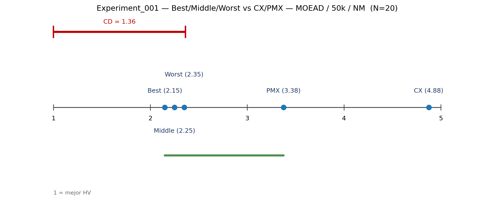
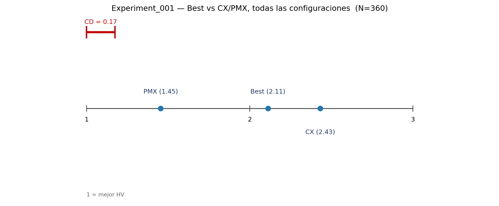
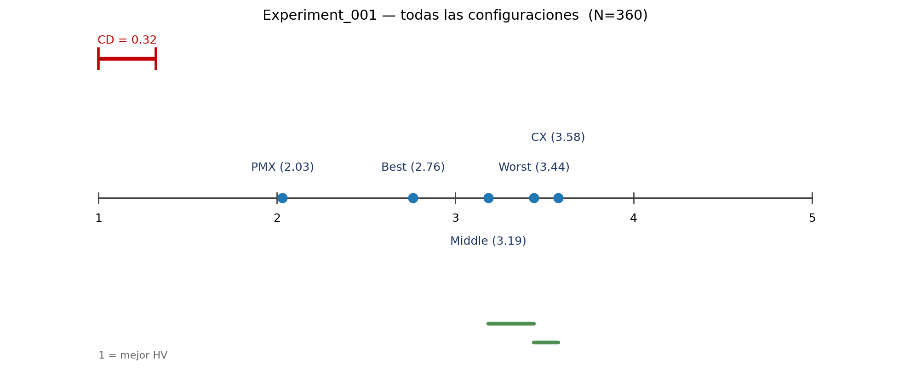

# Diferencias críticas (Demšar)

Prueba de Nemenyi, `alpha = 0.05`. Rango 1 = mejor HV.
Cada bloque es una instancia (o una combinación instancia × solver × mutación × presupuesto).

## Experiment_001 — MOEAD / 50k / NM (N = 20)



```text
Best    2.15
Middle  2.25
Worst   2.35
PMX     3.38
CX      4.88

CD = 1.36
```

`Best`, `Middle`, `Worst` y `PMX` no difieren significativamente entre sí.
`CX` queda separado y significativamente peor.

## Experiment_001 — Best vs CX/PMX, todas las configuraciones (N = 360)



```text
PMX   1.45
Best  2.11
CX    2.43

CD = 0.17
```

Los tres operadores difieren significativamente entre sí.
Orden global: `PMX` < `Best` < `CX`.

## Experiment_001 — cinco operadores, todas las configuraciones (N = 360)



```text
PMX     2.03
Best    2.76
Middle  3.19
Worst   3.44
CX      3.58

CD = 0.32
```

`PMX` y `Best` quedan separados del resto.
`Middle`, `Worst` y `CX` forman el grupo de peores rangos.
